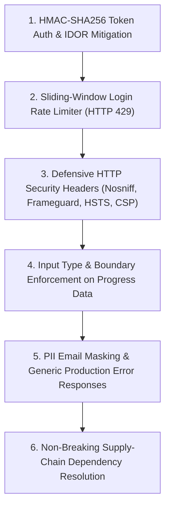

# CodeSaga Application Security Review — Executive Summary

**Target Application:** CodeSaga Platform (Backend Web API, React Frontend & Mobile App)  
**Evaluation Date:** October 26, 2026  
**Review Type:** Defensive SAST Code Review, Software Composition Analysis (SCA) & Security Remediation  
**Status:** All 6 Confirmed Application Vulnerabilities Remediated; Supply-Chain Dependencies Reconciled  

---

## 1. Executive Finding Metrics

| Finding Category | Discovered | Remediated | Pending / Documented | Verification Status |
| :--- | :---: | :---: | :---: | :--- |
| **Application Source Code (SAST / Auth)** | **6** | **6** | **0** | **100% Remediated & Verified** (20/20 Security Tests Passing) |
| • *High Severity (IDOR & Rate Limiting)* | 2 | 2 | 0 | Token authentication & sliding-window rate limiter active |
| • *Medium Severity (Headers & Validation)* | 2 | 2 | 0 | Defensive security headers & strict input boundary checks active |
| • *Low Severity (PII Logging & Error Leaks)* | 2 | 2 | 0 | Email masking & generic production error responses active |
| **Root Dependency Supply Chain (SCA)** | **17** | **10** | **7** | **Zero Critical Vulnerabilities Remaining**; 7 retained due to breaking-change trade-offs |
| • *Critical Severity* | 2 | 2 | 0 | `proxy-addr` and `shell-quote` fully patched |
| • *High Severity* | 9 | 4 | 5 | Vite, body-parser, brace-expansion patched; 5 retained in Expo CLI |
| • *Moderate Severity* | 6 | 4 | 2 | `qs`, `query-string` patched; 2 retained in `uuid`/`exceljs` |

---

## 2. Key Security Remediations Implemented

### 1. Insecure Direct Object Reference (IDOR / BOLA) Elimination
- **Endpoint Scope:** `GET /api/users/:email/progress`, `PUT /api/users/:email/progress`, `GET /api/users/:email/certificate`, `PUT /api/users/:email/certificate`.
- **Implementation:** Created native Node.js HMAC-SHA256 session token generation and timing-safe signature verification (`createAuthToken`, `verifyAuthToken`, `extractAuthUser`).
- **Enforcement:** Endpoints verify that the authenticated caller matches the target email parameter or has the developer role.
- **Outcome:** A user can no longer view or tamper with another detective's game progress or certificates by changing URL parameters. Guest access and legitimate unearned certificate behaviors remain preserved.

### 2. Authentication Rate Limiting
- **Endpoint Scope:** `POST /api/users/login-password` and `POST /api/users/set-password`.
- **Implementation:** Integrated an in-memory sliding-window IP rate limiter (`authRateLimiter`) enforcing a ceiling of 10 attempts per 15-minute window.
- **Outcome:** Exceeding 10 requests returns HTTP 429 (Too Many Requests) with a standard `Retry-After` header, defending against brute-force password guessing and bcrypt CPU exhaustion.

### 3. HTTP Security Response Headers
- **Scope:** Global Express middleware in `server.js`.
- **Implementation:** Configured `X-Content-Type-Options: nosniff`, `X-Frame-Options: SAMEORIGIN`, `Strict-Transport-Security: max-age=31536000`, `Referrer-Policy: strict-origin-when-cross-origin`, and an application-tailored `Content-Security-Policy` allowing legitimate CodeSaga font, script, image, and API origins.
- **Outcome:** Mitigates clickjacking, MIME-confusion, and protocol downgrade vectors without breaking frontend rendering or Android WebView execution.

### 4. Progress Payload Type & Range Validation
- **Endpoint Scope:** `PUT /api/users/:email/progress`.
- **Implementation:** Added `validateProgressInput` validating that XP, coins, streak, and level are non-negative bounded integers (`xp <= 10,000,000`, `coins <= 5,000,000`, `level <= 1,000`), and validating world identifiers against allowed game realms.
- **Outcome:** Protects MongoDB document integrity against corrupted or negative score injections.

### 5. Sensitive Data & Error Sanitization
- **Implementation:** Implemented `maskEmail` to sanitize PII across all logging statements (e.g. `d***8@gmail.com`). Replaced raw exception reflections in 500 handlers with `safeErrorResponse` returning generic messages in production while preserving diagnostics in development.
- **Outcome:** Eliminates cleartext email exposure in container stdout and prevents internal stack trace leaks.

### 6. Dependency Vulnerability Resolution & Reconciliation
- Reconciled discrepancies between npm audit and Trivy scanner outputs.
- Patched 10 vulnerabilities in the root lockfile, eliminating all Critical vulnerabilities.
- Documented trade-offs for remaining transitive packages (`expo` and `exceljs`) where automated fixes would introduce breaking major-version downgrades.

---

## 3. Verification & Validation Results

- **Security Regression Suite (`scripts/test-security-authorization.mjs`):** **20 / 20 Tests Passed (100%)**
  - Confirmed 401 on unauthenticated access across all protected routes.
  - Confirmed 403 on cross-account IDOR attempts.
  - Confirmed 200 on own-account authenticated access.
  - Confirmed guest session behavior preserved.
  - Confirmed 400 on negative XP and invalid worlds.
  - Confirmed all HTTP security headers present.
  - Confirmed 429 triggered on 11th consecutive login attempt.
- **Certificate & Chapter Verification Suite (`scripts/test-cert-and-chapters.mjs`):** **10 / 10 Tests Passed (100%)**
  - Confirmed legitimate certificate access for `deepkanair8@gmail.com`.
  - Confirmed chapter progression, isolation, and persistence across sessions.
- **Vite Build:** **Success** in 898ms with zero errors.
